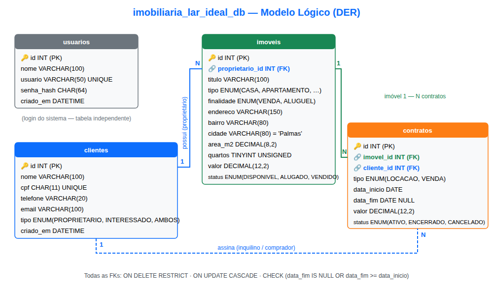

# 🏠 Imobiliária Lar Ideal

Sistema web para gestão de uma imobiliária, com **clientes**, **imóveis**, **contratos** de locação e venda e
**usuários** do sistema. Foi desenvolvido como trabalho da disciplina de Banco de Dados
(Análise e Desenvolvimento de Sistemas, Faculdade Serra do Carmo).

**Dupla:** Davi Barbosa Brito e Igo Patrick

## Tecnologias
- **Python 3 + FastAPI**: rotas e regras de negócio
- **MySQL 8**: banco relacional (`imobiliaria_lar_ideal_db`)
- **PyMySQL** com **SQL puro, sem ORM**, para deixar visíveis os comandos `INSERT`, `SELECT`, `UPDATE`, `DELETE` e `JOIN`
- **Jinja2 + Bootstrap 5**: telas

## Funcionalidades
- Login e logout com sessão; senhas guardadas como hash SHA-256
- Painel com indicadores, últimos contratos (JOIN) e imóveis disponíveis
- CRUD completo com pesquisa e filtros para **clientes, imóveis, contratos e usuários**
- Regras de negócio:
  - o status do imóvel (Disponível, Alugado ou Vendido) é atualizado automaticamente pelos contratos, na mesma transação
  - validação de datas, de tipo de contrato × finalidade do imóvel e de contrato duplicado
  - exclusão bloqueada pela chave estrangeira, com aviso amigável

## Banco de dados



| Tabela | Descrição | Relacionamentos |
|---|---|---|
| `usuarios` | Login do sistema | — |
| `clientes` | Proprietários e interessados | — |
| `imoveis` | Imóveis para venda ou aluguel | `proprietario_id → clientes.id` |
| `contratos` | Locações e vendas | `imovel_id → imoveis.id`, `cliente_id → clientes.id` |

O script completo (criação, carga de dados e consultas de demonstração) está em [`sql/script_imobiliaria.sql`](sql/script_imobiliaria.sql).

## Como executar
1. Execute `sql/script_imobiliaria.sql` no MySQL (no Workbench: `Ctrl+Shift+Enter`).
2. Configure e rode a aplicação:
   ```bash
   cp env.example .env          # edite com seu usuário e senha do MySQL
   python3 -m venv .venv && source .venv/bin/activate
   pip install -r requirements.txt
   uvicorn app.main:app --reload
   ```
3. Acesse http://127.0.0.1:8000 e entre com **admin / admin123**.

## Estrutura
```
app/
├── main.py            # app, login/logout e painel
├── database.py        # conexão MySQL (commit/rollback)
├── auth.py            # hash de senha e proteção das rotas
├── templating.py      # templates e filtros (moeda, data, CPF)
├── routers/           # clientes, imoveis, contratos, usuarios (CRUD)
└── templates/         # páginas HTML (Jinja2 + Bootstrap)
sql/script_imobiliaria.sql
docs/                  # DER e roteiro da apresentação
```
